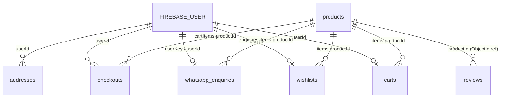

# SRI JVR TEXTILES — Database Schema

Both apps share one MongoDB database (`MONGO_URI`):

- **JVR** — the customer storefront (Next.js 14, app router). Customers sign in with **Firebase Auth**; every `userId` below is the Firebase UID. Customer profiles live in Firebase, not in MongoDB.
- **JVR-ADMIN** — the admin dashboard (Next.js 13, pages router). Admins sign in with a username and password stored in the `admins` collection and get a JWT cookie.

Mongoose models live in `JVR/lib/Schema/*` and `JVR-ADMIN/lib/Models/*`. If you change a shared collection, update both copies.

## Overview

| Collection | Model file (storefront) | Written by | Read by | Purpose |
|---|---|---|---|---|
| `products` | `productSchema.js` | Admin | Storefront, Admin | Catalogue: dresses with colour variants, sizes, stock and images |
| `carts` | `cartSchema.js` | Storefront | Storefront | One cart per customer |
| `wishlists` | `wishlistSchema.js` | Storefront | Storefront | **New.** Saved products per customer |
| `whatsapp_enquiries` | `whatsappEnquirySchema.js` | Storefront (logs clicks), Admin (follow-up fields) | Admin | **New.** Every "Order on WhatsApp" click, grouped per customer |
| `addresses` | `addressSchema.js` | Storefront | Storefront | Saved shipping addresses (used by the disabled checkout) |
| `checkouts` | `checkoutSchema.js` | Storefront (Razorpay, now disabled) | Storefront (My Orders), Admin (Orders) | Paid orders. Historical while checkout is off |
| `reviews` | `review.js` | Storefront (signed-in customers), Admin (delete) | Storefront, Admin | Product reviews with optional photos |
| `review_blocks` | `reviewBlockSchema.js` | Admin | Storefront, Admin | **New.** Customers blocked from writing reviews |
| `contacts` | `contactFormSchema.js` | Storefront (contact form), Admin (replies) | Admin (Enquiries) | Contact-us messages and admin replies |
| `admins` | — (admin only) | Set up by hand or with the script | Admin | **New.** Admin login accounts |

## Relationships



`productId` is stored as a **string** copy of `products._id` in carts, wishlists, enquiries and orders. Those collections also copy the name, price and image at the time of the action, so old records still read correctly after a product is edited or deleted. Only `reviews.productId` is a real `ObjectId` reference.

---

## `products`

| Field | Type | Notes |
|---|---|---|
| `_id` | ObjectId | |
| `productName` | String, required | |
| `productPrice` | Number, required | Selling price (₹) |
| `productOldPrice` | Number | MRP; the discount % is shown when it's higher than `productPrice` |
| `productVariants[]` | Array | One entry per colour |
| `productVariants[].color` | String, required | CSS colour value, e.g. `#1a1a1a` or `navy` |
| `productVariants[].sizes[]` | Array | `{ size: String, stock: Number }`, both required |
| `productVariants[].images` | [String], required | Cloudinary URLs; `[0]` is the main image and `[1]` is the hover image |
| `productDetails` | [String], required | Description paragraphs (may contain HTML) |
| `productCategory` | String, required | `mens`, `women` or `kids`; drives the main menu |
| `productType` | String, required | Sub-category, e.g. `Shirts` or `Sarees`; drives the sub-menus and search |
| `productBrand` | String, required | |

No timestamps. Stock is per colour **and** size (`productVariants[i].sizes[j].stock`).

## `carts`

One document per customer.

| Field | Type | Notes |
|---|---|---|
| `userId` | String, required | Firebase UID |
| `items[]` | Array | |
| `items[].productId` | String, required | |
| `items[].productName` / `productPrice` / `productImage` | String / Number / String, required | Copied from the product |
| `items[].productColor` / `productSize` | String, required | Selected variant |
| `items[].productStock` | Number, required | Stock when the item was added |
| `items[].quantity` | Number, required | |
| `items[].variantId` | String, required | `productVariants._id` |
| `createdAt`, `updatedAt` | Date | |

## `wishlists` (new)

One document per customer. Items are unique by `productId`.

| Field | Type | Notes |
|---|---|---|
| `userId` | String, required, **unique** | Firebase UID (taken from the verified ID token, never from the request body) |
| `items[]` | Array | |
| `items[].productId` | String, required | |
| `items[].productName` | String, required | Copied from the product |
| `items[].productPrice` | Number, required | |
| `items[].productOldPrice` | Number | |
| `items[].productImage` | String | First image of the first variant |
| `items[].productCategory` | String | |
| `items[].addedAt` | Date | |
| `createdAt`, `updatedAt` | Date | Mongoose timestamps |

API (storefront): `GET /api/wishlist`, `POST /api/wishlist { productId }`, `DELETE /api/wishlist?productId=…`. Every call needs `Authorization: Bearer <Firebase ID token>`.

## `whatsapp_enquiries` (new)

Each time a customer taps **Order on WhatsApp** (from the cart, the cart drawer, a product page or the wishlist), the storefront opens WhatsApp with a pre-filled order message and logs the click here. Each customer has **one document**, and every click is added to `enquiries[]` with its date and the products involved, so a returning customer's history stays nested in one place.

| Field | Type | Notes |
|---|---|---|
| `userKey` | String, required, **unique** | Firebase UID for signed-in customers; `guest:<visitorId>` for anonymous visitors (random ID kept in their browser) |
| `userId` | String \| null | Firebase UID |
| `isGuest` | Boolean | |
| `name`, `email`, `phone` | String | From the Firebase account; empty for guests |
| `enquiries[]` | Array | One entry per click, oldest first |
| `enquiries[].source` | `cart` \| `product` \| `wishlist` | Where the click came from |
| `enquiries[].items[]` | Array | `{ productId, productName, productImage, price, color, size, quantity }` |
| `enquiries[].totalAmount` | Number | Σ price × quantity |
| `enquiries[].pageUrl` | String | Page the customer was on |
| `enquiries[].createdAt` | Date | Time of the click |
| `totalEnquiries` | Number | Count of clicks |
| `lastEnquiryAt` | Date | Use this to sort the follow-up list |
| `followUpStatus` | `new` \| `contacted` \| `converted` \| `not_interested` | Set by the team in the admin dashboard |
| `followUpNotes` | String | Free-text notes from the team |
| `createdAt`, `updatedAt` | Date | Mongoose timestamps |

API (storefront): `POST /api/whatsapp/enquiry { source, items[], pageUrl, visitorId }`. The `Authorization` header is optional: with a valid Firebase token the click is linked to that customer, otherwise it's logged as a guest. Inputs are validated and capped at 50 items.

Example:

```json
{
  "userKey": "Xy12AbC…",
  "userId": "Xy12AbC…",
  "isGuest": false,
  "name": "Priya",
  "email": "priya@example.com",
  "totalEnquiries": 2,
  "lastEnquiryAt": "2026-10-25T10:42:00Z",
  "followUpStatus": "new",
  "enquiries": [
    { "source": "product", "createdAt": "2026-10-20T08:10:00Z", "totalAmount": 1299,
      "items": [{ "productName": "Cotton Saree", "color": "#8b0000", "size": "Free", "quantity": 1, "price": 1299 }] },
    { "source": "cart", "createdAt": "2026-10-25T10:42:00Z", "totalAmount": 2398,
      "items": [{ "productName": "Linen Shirt", "size": "L", "quantity": 2, "price": 1199 }] }
  ]
}
```

## `addresses`

| Field | Type |
|---|---|
| `userId` | String, required |
| `fullName`, `phone`, `addressType`, `addressLine1`, `city`, `state`, `postalCode`, `country` | String, required |
| `addressLine2` | String |

## `checkouts` (orders)

Written only by the Razorpay flow, which is **disabled** while `NEXT_PUBLIC_CHECKOUT_ENABLED` is not `true`. Existing orders stay readable in My Orders and in the admin Orders list.

| Field | Type | Notes |
|---|---|---|
| `userId` | String, required | |
| `cartItems[]` | Array | `{ productImage, productId*, productName*, quantity*, price*, color*, size* }` (`*` = required) |
| `shippingAddress` | Object | Same fields as `addresses` (`addressLine2` optional) |
| `paymentDetails` | Object | `{ method*, transactionId*, status* (default "Pending") }` |
| `orderTotal` | Number, required | |
| `orderStatus` | String, required | Default `Processing`; updated from the admin dashboard |
| `stockUpdated` | Boolean | Prevents deducting stock twice (verify route + webhook) |
| `createdAt`, `updatedAt` | Date | |

## `reviews`

| Field | Type | Notes |
|---|---|---|
| `user` | String, required | Display name |
| `userId` | String, indexed | Firebase UID of the author. Missing on reviews posted before login was required; those can be deleted but not blocked |
| `userEmail` | String | Shown only in the admin, never on the storefront |
| `productId` | ObjectId → `products`, required | |
| `rating` | Number, required | 1–5 |
| `imageUrls` | [String] | Cloudinary URLs (up to 4) |
| `comment` | String, required | Up to 2000 characters |
| `createdAt`, `updatedAt` | Date | |

Any signed-in customer can review any product, with one review per customer per product; posting again updates it. `POST /api/review/addReview` takes the author from the Firebase token and refuses customers listed in `review_blocks`. `GET /api/review/mine?productId=…` returns `{ blocked, review }` for the signed-in customer.

## `review_blocks` (new)

Customers an admin has blocked from writing reviews (admin → Reviews → block).

| Field | Type | Notes |
|---|---|---|
| `userId` | String, required, **unique** | Firebase UID |
| `name`, `email` | String | Copied from the customer's latest review |
| `reason` | String | Internal note for admins |
| `createdAt`, `updatedAt` | Date | `createdAt` = when they were blocked |

## `contacts`

| Field | Type | Notes |
|---|---|---|
| `name`, `email`, `subject`, `message` | String, required | |
| `phoneNumber` | Number, required | |
| `replies[]` | Array | `{ email, message, createdAt }`, added by admins |
| `isOpened` | Boolean | Read/unread flag in the admin inbox |
| `createdAt`, `updatedAt` | Date | |

## `admins` (new, admin dashboard only)

| Field | Type | Notes |
|---|---|---|
| `username` | String, required, **unique** | |
| `password` | String, required | **bcrypt hash** (a plain-text value still works but logs a warning) |
| `name` | String | |
| `createdAt` | Date | |

There's no sign-up anywhere. Create the login with `npm run create-admin -- <username> <password>` in JVR-ADMIN, or insert a document by hand (see the JVR-ADMIN README).

## Suggested indexes

The `unique` fields above create indexes automatically. These also help as the data grows:

```js
db.carts.createIndex({ userId: 1 })
db.addresses.createIndex({ userId: 1 })
db.checkouts.createIndex({ userId: 1, createdAt: -1 })
db.reviews.createIndex({ productId: 1, createdAt: -1 })
db.products.createIndex({ productCategory: 1, productType: 1 })
db.whatsapp_enquiries.createIndex({ lastEnquiryAt: -1 })
db.whatsapp_enquiries.createIndex({ followUpStatus: 1, lastEnquiryAt: -1 })
```
